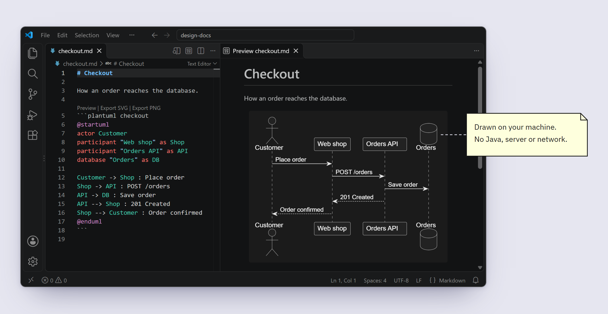
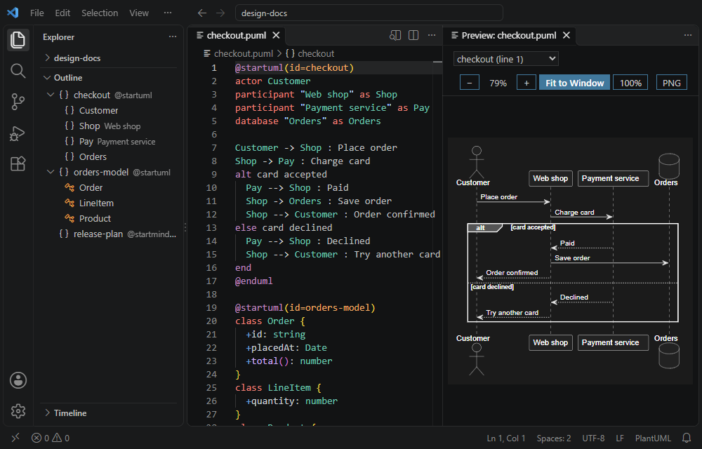
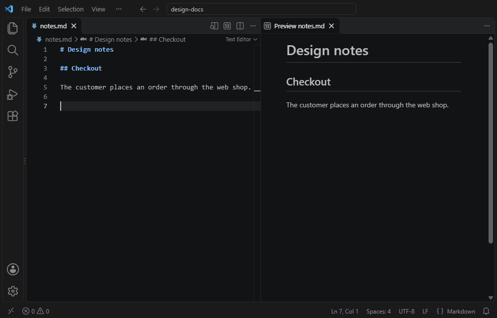
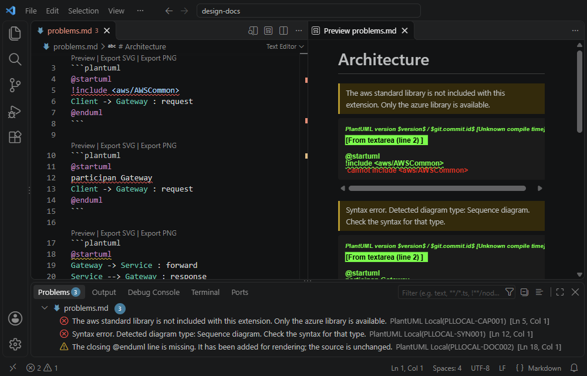
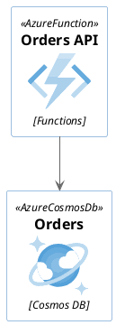
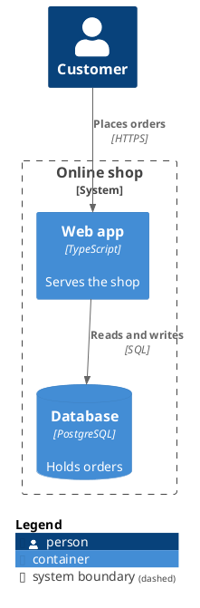
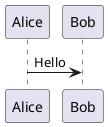
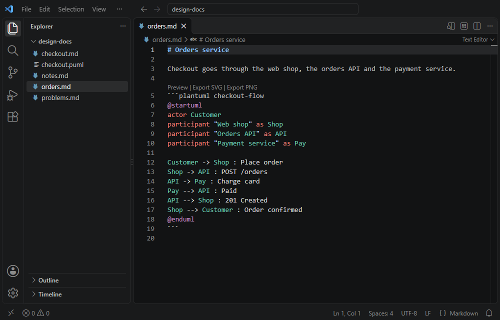

# PlantUML Local

[](https://opensource.org/licenses/MIT)
[](https://github.com/kkdev92/plantuml-local/actions/workflows/ci.yml)
[](https://marketplace.visualstudio.com/items?itemName=kkdev92.plantuml-local)
[](https://www.typescriptlang.org/)
[](https://www.bestpractices.dev/projects/14052)

Render ```` ```plantuml ```` code blocks in the built-in Markdown preview, and `.puml` files in a preview of their own — no Java, no server, no network connection.
Your diagram source is processed locally and is not sent to a rendering service.
*Built for design docs you can't send anywhere — write, preview, done.*

> **Status:** Active (best-effort maintenance)



---

## Table of Contents

- [Features](#features)
- [Installation](#installation)
- [Quick Start](#quick-start)
- [Why PlantUML Local](#why-plantuml-local)
- [Usage](#usage)
- [Known Limitations](#known-limitations)
- [Configuration](#configuration)
- [How It Works](#how-it-works)
- [Security and Privacy](#security-and-privacy)
- [Platform Requirements](#platform-requirements)
- [Troubleshooting](#troubleshooting)
- [Contributing](#contributing)
- [Support & Maintenance Policy](#support--maintenance-policy)
- [License](#license)
- [Acknowledgments](#acknowledgments)

---

## Features

- **Built-in Preview**: Diagrams appear in the same Markdown preview you already use
- **`.puml` Files**: PlantUML files open as their own language, with folding, an outline and a preview beside the editor that zooms — to an area you mark, too, with *Zoom to Area* — scrolls to the diagram's edges with `Home` and `End`, exports PNG and copies the diagram to the clipboard, as a PNG or as SVG text
- **Local Includes**: `!include`, `!includesub` and `!theme … from` read shared definitions, sections and themes from the files of your workspace folder, in a trusted workspace; their paths complete, and Ctrl+Click opens the file
- **Syntax Highlighting**: ```` ```plantuml ```` blocks and `.puml` files are coloured in the editor, following the syntax the bundled engine accepts
- **Offline Rendering**: No Java, no PlantUML server, no network connection required — nothing to install besides the extension
- **C4 and Azure Libraries**: `!include <C4/C4_Container>` and the other C4 modules, and the Azure icons with `!include <azure/…>`, ship inside the extension and render offline
- **Fault-Tolerant**: A syntax error shows up inline at the broken diagram; the rest of the page stays intact
- **Problems Panel**: Errors, warnings and unsupported syntax in the diagrams of open Markdown and PlantUML files are listed with their line, preview or not
- **Writing Help**: Completion for start lines, directives, themes and icons, the aliases and words of the diagram you are in, the procedures, functions and variables it and the files it includes define — with parameter hints for their calls — snippets of sequence and activity blocks, templates for sixteen kinds of diagram, and quick fixes that name a diagram for export and add a missing end line
- **Go to Definition**: `F12`, Ctrl+Click and Peek on a call, a variable or a participant lead to where the diagram, a file it includes or a bundled library defines or declares it — never to another diagram — and a file of the C4 and Azure libraries opens read-only
- **Find All References**: `Shift+Alt+F12`, `Shift+F12` and Peek list each call and use of a procedure, function or variable, and each line naming a participant, that leads to the same definition — in the diagram and the files it includes, never in another diagram
- **Hovers**: A directive, the kind of diagram after `@start`, a bundled theme and an OpenIconic icon show what they do and how they are written, in English or Japanese, with nothing fetched; a call or a variable shows each definition it may stand for, with the comment above it as written; the path of an include shows the file it reads, or why it reads none
- **Actions Above Each Diagram**: *Preview*, *Export SVG* and *Export PNG* sit above the first line of each diagram, in `.puml` files and Markdown alike, and act on that diagram
- **Go to Diagram**: *Go to Diagram in Document…* lists the diagram blocks of a Markdown file — with the heading above each, its kind and its title or first line — and moves the cursor to the one picked
- **Colours**: A swatch beside each colour a diagram sets — a `skinparam` value, an element's colour, a `<style>` property — opens VS Code's colour picker, which writes the pick back as `#RRGGBB`
- **Export**: Diagrams can be written to SVG files — one, a whole document or a whole folder — or to PNG files, one or a whole folder, and referenced from the Markdown, for hosts such as GitHub that do not draw PlantUML
- **Multi-Diagram Pages**: Any number of diagrams per page; renders are serialised so results never mix
- **Dark-Mode Aware**: Diagrams re-render to match your colour theme, or pin the palette via settings
- **Full-Width Text Support**: Japanese and other full-width characters are measured and laid out correctly
- **Non-Intrusive**: All other fenced code blocks (` ```js `, ` ```mermaid `, …) are left untouched
- **Local by Design**: Rendering is isolated in a worker thread; only sanitised SVG reaches the preview

---

## Installation

### Install from VS Code Marketplace (recommended)

- Open the Extensions view (`Ctrl+Shift+X`)
- Search for **PlantUML Local**
- Click **Install**

You can also open the Marketplace page directly:

- <https://marketplace.visualstudio.com/items?itemName=kkdev92.plantuml-local>

### Build from Source (for contributors)

> If you just want to use PlantUML Local, installing from the Marketplace is the easiest option.

```bash
git clone https://github.com/kkdev92/plantuml-local.git
cd plantuml-local
npm install
npm run install-local
```

---

## Quick Start

1. Open any Markdown file
2. Add a fenced code block with the `plantuml` language (`puml` works too):

   ````markdown
   ```plantuml
   @startuml
   Alice -> Bob : Hello
   @enduml
   ```
   ````

3. Open the preview: the preview button at the top right of the editor, or **Markdown: Open Preview** (`Ctrl+Shift+V` by default)
4. The block renders as a diagram — edit it, and the diagram follows as you type

See [sample.md](sample.md) for a tour of diagram types, including error handling, and [sample.puml](sample.puml) for a PlantUML file of its own.

---

## Why PlantUML Local

Previewing PlantUML in VS Code usually means one of two things: installing a Java
runtime to run `plantuml.jar` locally, or handing your diagram source to a
PlantUML server. The server route is often the public one at `plantuml.com`,
which means the source of every diagram is encoded into a URL and sent out on
each preview — not always acceptable for confidential or internal design
documents.

PlantUML Local takes a third route: it renders ```` ```plantuml ```` blocks on
your own machine and inserts the resulting SVG into VS Code's built-in Markdown
preview.

- No Java runtime
- No PlantUML server
- No separate preview panel for Markdown
- No network connection required to render

The extension bundles the official
[`@plantuml/core`](https://www.npmjs.com/package/@plantuml/core) JavaScript
build of PlantUML; Graphviz layout is provided locally by Viz.js compiled to
WebAssembly.

---

## Usage

PlantUML Local renders most diagram types available in the bundled PlantUML
browser engine, including sequence, use-case, class, state, activity and
component diagrams.

The first render after startup is the slow one — around half a second on a
typical development machine while the WebAssembly engine initialises. Later
renders are considerably faster, though timings depend on the machine and on
how complex the diagram is.

If a diagram looks stale, run `PlantUML Local: Clear Render Cache and Re-render`
from the Command Palette.

A changed diagram is drawn again as you type. For a large one,
`plantumlLocal.preview.updateMode` can wait instead: `onSave` draws it again
when the file is saved, and `manual` only with *Clear Render Cache and
Re-render*. Until then the Markdown preview and the `.puml` preview keep the
diagram they show, with a note that it is not updated. A diagram shown for the
first time is drawn whatever the mode; the Problems checks still follow every
change, and export always uses the current text.

A diagram whose `@enduml` line is missing is drawn as if the block ended with
one, with a note above it saying so; the export writes it the same way. Lines
above `@startuml` in a block are left out of the drawing, as the engine reads
it, and a note above the diagram says so too.

### Syntax highlighting

` ```plantuml ` and ` ```puml ` blocks are also coloured in the editor, including
ones inside block quotes and list items. As with the preview, only these two
languages count, exactly — ` ```PlantUML ` and ` ```uml ` stay plain. The grammar follows the syntax supported by
the bundled PlantUML engine, and covers every diagram type that engine
renders:

- the JSON and YAML inside `@startjson` / `@startyaml` are coloured by VS
  Code's own JSON and YAML grammars
- diagram types the bundled engine does not render (`@startditaa`, …) are
  marked invalid
- some older forms the engine accepts only with a warning — a colour in front
  of an activity (`#pink:text`), `label on first column` in a Gantt chart — are
  marked deprecated

Tokens carry the usual TextMate scope names with a `.plantuml` suffix
(`keyword.other.plantuml`, `entity.name.type.plantuml`, …), so any colour
theme applies, and `editor.tokenColorCustomizations` can adjust them.

Files ending in `.puml`, `.plantuml`, `.pu`, `.iuml` or `.wsd` open as the
language PlantUML, with the same colouring. *Toggle Line Comment* uses `'` and
*Toggle Block Comment* uses `/' … '/`. A `.puml` file has a preview of its own
(below), and its diagrams can be exported to SVG or PNG.

In a `.puml` file, each diagram folds from its `@start…` line, and so do block
comments, multi-line notes, legends, headers, footers, titles and `ref over`
blocks, `{ … }` bodies, preprocessor sections (`!if`, `!procedure`, `!foreach`,
…), sequence groups (`alt`, `loop`, …) and activity blocks (`if`, `while`,
`fork`). A file with none of these folds by indentation; to fold every
PlantUML file that way, set `"editor.foldingStrategy": "indentation"` under
`"[plantuml]"` in the settings.

The Outline view, the breadcrumbs and *Go to Symbol in Editor* (Ctrl+Shift+O;
Cmd+Shift+O on macOS) list the diagrams of a `.puml` file, each by its id or
its start line, and what each declares with a keyword: `participant`, `actor`
and the other participants of a sequence diagram, `class`, `interface`,
`enum`, `annotation`, `component`, `node`, `package`, `namespace`, `state` and
`usecase`. A declaration is listed by its alias, with the name the diagram
shows beside it, and what a `{ … }` body declares sits under it. A name that
only appears in a relation, or that a procedure creates, is not listed.

### Previewing `.puml` files

*PlantUML Local: Open Diagram Preview to the Side* — the preview button in the
title bar of a `.puml` file's editor — opens a panel showing the diagram under
the cursor. The panel stays with that file while the focus moves elsewhere,
lists the file's diagrams when it holds several, and draws the diagram again as
the file changes. Running the command again in the same file brings its panel
back rather than opening another. *Open Diagram Preview* does the same in the
editor's own group (or hold Alt on the button). A panel left open comes back
when VS Code restarts, on the same diagram when that diagram has a name, and
otherwise asking which one to show.



The diagram is first fitted to the panel, never past 100% — the size the
diagram gives itself, which PlantUML's `scale` sets. The buttons above it zoom
out and in, fit it, and show it at 100%; so do the keys `-`, `+`, `0` and `1`.
Ctrl+wheel (Cmd on macOS) or a pinch zooms at the pointer, the wheel scrolls,
dragging moves the diagram, and the arrow keys move it by 40 pixels (200 with
Shift). *Zoom to Area* (`Z`) has the next drag mark an area instead, and zooms
to fit that area in the panel; Esc leaves it without zooming. `Home` and `End`
scroll to the top and the bottom of the diagram, with Shift to its left and
right edges, and `C` to its centre; the panel's context menu has these too.
None of these keys does anything while the list of diagrams has the focus.
Each diagram keeps its zoom and position while it is redrawn, while
the panel is hidden, and across a restart. The PNG button beside them exports
the diagram shown as *Export Diagram as PNG* does, at its own size and scale
rather than the zoom of the panel, and in the palette of exports: light,
whatever the editor theme, unless `plantumlLocal.exportTheme` says otherwise.

The Copy button puts that same PNG on the clipboard instead of in a file, to
paste into a chat, a slide or a document; so do Ctrl+C (Cmd+C on macOS) in the
panel and *Copy* in its context menu. The panel says when the image is on the
clipboard, or why it is not: a diagram the PNG button would not export, such
as one with an error or one past the size limit of a PNG, is not copied either.
*Copy SVG* puts the diagram's SVG on the clipboard as text instead — what
*Export Diagram as SVG* would write, to paste into a file or a tool that takes
SVG — and a notice says when it is there, or why it is not. The size limit of
a PNG does not apply to it; an SVG over 32 MiB is not copied, and the notice
then offers *Export as SVG*, as it does when the clipboard does not take the
text.

For a screen reader, the image and the drawing area carry the diagram's name:
the title it draws, else its name — the id on its start line, or the file's
name for a file's only diagram — else its place in the file, as *Diagram 2 of
flows*. As you type, the diagram is drawn again and again; the screen reader
is told only what that comes to — that it was rendered, or why not — once
drawing settles, and is not told it again until it changes. It also hears the
zoom the buttons, keys, wheel and *Zoom to Area* leave and what came of a
copy, and VS Code reads out the notice of an export itself. Tab goes from the
list to the zoom buttons, which are one stop, then on through PNG, Copy and
Copy SVG to the drawing area, showing where the focus is; Enter or Space
presses a button. On the zoom buttons, the left and right arrow keys move
between them, round from either end, rather than moving the diagram.

The panel shows the SVG as an image, so nothing in it can run, and loads
nothing but its own script and stylesheet.

### Actions above each diagram

*Preview*, *Export SVG* and *Export PNG* sit above the first line of each
diagram — the `@start…` line in a `.puml` file, the opening fence of a block
in Markdown — and act on that diagram, wherever the cursor is. In a `.puml`
file, *Preview* opens the file's preview beside the editor on that diagram. In
Markdown, it selects the block and opens VS Code's Markdown preview beside the
editor, which follows the editor's scrolling rather than the block. The two
exports write the diagram as *Export Diagram as SVG* and *Export Diagram as
PNG* do, under the same conditions: a saved file in a trusted workspace, and a
name for the diagram, asked for when it has none. A block holding several
diagrams, which cannot be exported as one, gets *Preview* only, and a `.puml`
file with no `@start…` line, whose lines are meant to be included, gets
nothing. `plantumlLocal.codeLens.enabled` turns the actions off, per folder if
wanted; so does VS Code's `editor.codeLens`, for every extension's.

### Going to a diagram in a Markdown file

*PlantUML Local: Go to Diagram in Document…* lists the diagram blocks of the
Markdown file in the editor — named or not, drawn or not, in a block quote or
a list item — each with its line, the kind its start line declares, the
heading above it and its title or first line, and moves the cursor to the
block picked. The list filters on all of that: `mind` finds the mind map,
`Orders` the blocks under that heading. Edited while the list is open, the
file is read again, so a pick lands where the block is then. Nothing is drawn
for the list, and VS Code's own outline of the headings is as it was. From the
block, the *Preview* action above it opens the Markdown preview.

### Completion

In a diagram — a ` ```plantuml ` block or a `.puml` file — suggestions open on:

- `@` at the start of a line: the start line of each diagram type the bundled
  engine draws, or inside a diagram, its end line
- `!` at the start of a line: the preprocessor directives
- `!theme `: the themes that ship with the extension
- `<&`: the names of the OpenIconic icons
- `!include ` and a `/` in its path: the folders and the files it can include
  (see [Including files](#including-files))

Where a diagram can start, `puml-` offers a template of sixteen kinds of
diagram — sequence, class, activity, state, component, use case, object,
entity relationship, deployment, timing, Gantt, mind map, WBS, Salt, JSON and
YAML — with its names to tab through, each drawn as it is by the bundled
engine: a whole ` ```plantuml ` block in the text of a Markdown file, the bare
diagram in an empty block or between the diagrams of a `.puml` file.
*PlantUML Local: Insert Diagram Template* does the same from the command
palette: pick the kind, and the template goes on lines of its own at the
cursor, inside the block quote or list item the cursor is in, as one edit that
one Undo takes back. In a block that already holds a
diagram, it asks to add a new block after it; in a diagram, a comment or a block
of another language, it says why it does not.

Elsewhere in a diagram, the list offers what that diagram holds, and nothing
from other diagrams or from documents it does not include:

- the aliases it declares, each with the name it shows: `A` with `Order desk`
  for `participant "Order desk" as A`, `web` with `Web` for
  `component [Web] as web`
- in a sequence or an activity diagram, on a line of its own, snippets of its
  blocks with their parts to tab through: `alt`, `opt`, `loop`, `par`, `ref`
  and `note`, or `if`, `while`, `repeat` and `fork`. A `@startuml` diagram is
  taken for one or the other by lines that only that type reads, such as
  `participant` or `activate`, and `start` or `:action;`. Where its lines do
  not tell, no snippet is offered
- the procedures, functions, macros and variables defined before the cursor,
  in the diagram or in the files it includes (see
  [Definitions and parameter hints](#definitions-and-parameter-hints))
- its words, cut as VS Code cuts them, leaving out those of comments, quoted
  text and notes

The words take the place of VS Code's own word suggestions, which come from
every open document of the language, and follow their setting,
`editor.wordBasedSuggestions`: with `off` there are none. By default
(`offWithInlineSuggestions`) VS Code lists no words in a PlantUML file while
inline suggestions are on there, which an extension cannot tell; so in a
`.puml` file the diagram's words come only beside its aliases, snippets or
definitions, and where they would come alone, the list is left to VS Code.

Markdown turns quick suggestions off, so in a Markdown file the list opens on
those characters, or with *Trigger Suggest* (`Ctrl+Space`) — type `puml` and
press it for the templates.



### Definitions and parameter hints

The completion offers what a diagram defines before the cursor, and what the
files it includes define there — files of the workspace and the bundled C4
and Azure libraries alike:

- procedures, functions and macros: `!procedure`, `!function`, `!define` and
  `!definelong`
- variables, set with `!$name = …`, `?=`, `!global` or `!local` or by a
  `!foreach`, and the names a `!define NAME value` gives a value
- in the body of a procedure or a function, its parameters

Each shows its parameters, where it is defined — this diagram, a file of the
workspace, or a file of a library such as `<C4/C4_Context>` — and what defines
it; its details show how it is declared, its line and the comment lines above
it as written. Picking a procedure, function or macro writes the call with a
placeholder for each parameter up to the last that has no default, and opens
the parameter hints. Typing `$`, or a name that starts with it, lists only the
names that start with `$`, as does a place in the text of the diagram —
quoted text, a note, a title — or in the path of an `!include`.

The parameter hints open on `(` and `,` in a call of a name defined before
it, or with *Trigger Parameter Hints* (`Ctrl+Shift+Space`). They show each
definition of the name with its parameters as declared, their defaults as
written, and the parameter the cursor is in: counted by place, commas in
quoted text and in brackets aside, or matched by name for an argument written
`$name = value`. In a C4 diagram, for instance, typing `Pers` offers `Person`
from `<C4/C4_Context>`; picking it writes `Person($alias, $label)` with the
two names to tab through, and in `Person(customer, ` the hints show
`Person($alias, $label, $descr = "", $sprite = "", $tags = "", $link = "",
$type = "")` with `$label` marked.

As in the bundled engine, which reads a diagram from the top, a definition
counts from its line on, and one in an included file from the line of the
include. A name is offered once for each number of parameters, which the
engine tells apart, and a later definition stands for an earlier one.
Nothing is run to find them, so a definition the diagram may leave out —
under `!if`, `!ifdef`, `!ifndef`, `!while` or `!foreach`, or in a file
included under one — is marked *conditional*. Several that may hold are
marked *ambiguous*, and none of them is shown as the one that does. An
include that is not read here but may be when the diagram is drawn — one
whose path is put together then, one that picks a diagram by a pattern, or a
file past the size limits below — may define anything again, so what is
defined before it is marked *unresolved*. An include of a file that cannot be
read at all, such as a missing file or a file of the workspace in Restricted
Mode, defines nothing and marks nothing before it. Comments, quoted text and
the data of a sprite define nothing. A PlantUML file with no start line — one
that only other files include — is read whole, as one diagram, as its preview
draws it: what it and the files it includes define is offered there, and not
what a file that includes it defines.

Files of the workspace are read as for the preview (see
[Including files](#including-files)): in a trusted workspace, from the
document's workspace folder, with their unsaved changes. The Language Status
of the document — `{}` beside the language in the status bar — says what is
offered: *Definitions: diagram and includes*, marked *(partial)* when an
include was not read, in which case the *PlantUML Local* output says which
and why, once each time that changes. A document or an included file larger
than 2 MiB or longer than 50,000 lines is not read for definitions, and at
most 5,000 are offered.

### Going to a definition

*Go to Definition* (`F12`), Ctrl+Click and *Peek Definition* (`Alt+F12`) on
a name in a diagram lead to where it is defined:

- a call of a procedure, a function or a macro, and a variable, to its
  definition, found as the completion finds it: in the diagram before the
  cursor, or in a file it includes — of the workspace, or of the bundled C4
  and Azure libraries. A call leads to the definition the engine would pick
  for it, by the number of arguments given by place and the names of those
  given as `$name = value`; a parameter, in the body of its procedure or
  function, to the line that declares it
- a participant, a class, a component or another element a line declares
  with its keyword (`participant`, `actor`, `class`, `component`, `usecase`
  and the like), to each line that declares it — by its alias, or its name
  when it has none — in the diagram the cursor is in: never to the same name
  in another diagram of the file or the Markdown document
- the path of an include of a bundled library, such as `<C4/C4_Context>`, to
  the start of that file

A definition is taken from its line to the end of its body, which holding
`Ctrl` over the name previews, and opens with its name selected. Where
several may hold — one in each branch of an `!if`, say — each of them is
listed. Nothing is found for a definition marked *unresolved* above, which
an include that is not read here may replace, for a name nothing declares,
or in a comment. A word of a label, after the `:` of a line, names no
element; in quoted text, a note or a title, and in the path of an include,
only a name that starts with `$` leads anywhere. Included files of the
workspace are read as for the completion, with their unsaved changes, and
the Language Status and the output say which includes were not read.

A file of a bundled library opens read-only, named as an include names it —
`C4/C4_Context.puml` — with the text the extension bundles: the lines the
engine reads, so a line there is the line the completion shows. The file
holds no `@startuml` line, so it is read whole, as a file of the workspace
without one: a name in it leads on to where the file, or a file it includes,
defines it.

### Finding references

*Find All References* (`Shift+Alt+F12`), *Go to References* (`Shift+F12`) and
*Peek References* on a name in a diagram list each place Go to Definition
would lead from to the same definition:

- for a procedure, a function or a macro, each call that picks that
  definition, and for a variable, each use that reads it — from a call, a use
  or the name its definition declares; for a parameter, each use in the body
  of its procedure or function
- for an element a line declares with its keyword, each line of the diagram
  that names it before its label

The list starts with the definition, or each line that declares the element,
unless the command leaves them out. It covers the diagram the cursor is in
and the files of the workspace its includes read, with their unsaved changes
— each line of an included file read with what is defined where the diagram
includes it — but not another diagram of the file or the Markdown document,
the files of the bundled libraries, whose definitions are listed but not
searched, or the files that include the one searched. A file with no start
line is searched within itself and the files it includes.

A name in a comment, an element's name in a label, a name not starting with
`$` in quoted text, a note, a title or the path of an include, and a use
marked *unresolved* above — one an include that is not read here may define
again — are not listed; the Language Status then says *(partial)* and the
output which includes were not read. At most 5,000 places are listed, and
when the list stops there, the Language Status and the output say so.

### Hovers

Hovering in a diagram — a ` ```plantuml ` block or a `.puml` file — shows
help that ships with the extension on what the engine reads alike in every
diagram:

- a preprocessor directive the completion offers after `!` — `!include`,
  `!if`, `!procedure` and the rest — with `unquoted` and `final` before
  `procedure` or `function`, and the `return` after the parameters of a
  function written on one line
- the kind of diagram after `@start`, as in `@startuml`, `@startgantt` or
  `@startmindmap`
- a theme bundled with the extension, after `!theme`
- an OpenIconic icon, as in `<&heart>`

Each says what it does and shows how it is written — for a kind of diagram,
as a small diagram of that kind — and most directives come with an example.
The bundled engine draws the small diagrams and the examples as they are.
The help is in English, or in Japanese when that is VS Code's display
language, and nothing is fetched to show it. As the engine reads them, a
directive counts in lower case only, and a theme or an icon by its own name,
in its own case: `!Include`, `!theme Plain` and `<&Heart>` get no help. Nor
does a theme or an icon whose name holds a word the diagram defines, as the
engine may put a value in its place; where that word is a variable, the
hover shows its definition instead. The keywords of each kind of diagram and
the names of `skinparam` and style items have no help.

On a call of a procedure, a function or a macro, on a variable, and on a
parameter in the body of its procedure or function, the hover shows the
definitions the name may stand for, found as Go to Definition finds them:
each as declared, where — this diagram, a file of the workspace or a file of
a library such as `<C4/C4_Context>`, with its line — and the comment lines
above it as written, up to 20 lines and 2,000 characters. It shows ten at
most, and says how many more there are. Above them, a line says where they
are, what defines them and how sure that is, as the completion does:
*conditional*, *ambiguous* or *unresolved* (see
[Definitions and parameter hints](#definitions-and-parameter-hints)). Unlike
Go to Definition, the hover also shows a definition marked *unresolved*. An
element's name, such as a participant's, has no hover.

On the path of an `!include`, `!include_once`, `!include_many` or
`!includesub`, and on the name and the folder of `!theme … from`, the hover
says which file the diagram reads there, found as the preview finds it, or
why it reads none — a missing file, a path outside the workspace folder,
Restricted Mode — in the words of the preview. On the path of a bundled
library, such as `<C4/C4_Context>`, it says whether the extension bundles
that file, and on a URL, that URLs are not supported. A path the engine works
out — from a variable, a function, or a name the diagram defines — and one
written in a procedure or a function, which is read when that runs, are not
looked up: the hover says so, and on a variable in the path shows its
definition.

Hovers are written as untrusted Markdown with HTML turned off, and the text
of the documents in them — declarations, comments, paths — is escaped or put
in code blocks, so that a link, an image or HTML in a comment is shown as
written rather than followed, loaded or run. Included files of the workspace
are read as for the completion, with their unsaved changes, and the Language
Status and the output say which includes were not read.

### Colours

A swatch sits beside each colour a diagram sets where the extension can edit
it: the value of a `skinparam`, on its own line or in a `skinparam … { }`
block; the colour at the end of an element's declaration, as in `class Order
#pink`; and a colour property in a `<style>` block. The swatch shows the
colour as written — `#ABC`, `#AABBCC` or a name the bundled engine knows,
such as `#pink` or `#Business` — not as the palette draws it in a dark
editor. Clicking it opens VS Code's colour picker, and a pick is written back
as `#RRGGBB` in place of the token, as one edit. A pick with an alpha is
offered nothing to write, as the token cannot carry it. A gradient
(`#red/blue`), a colour with a style modifier (`#red;line:blue`), a colour
with an alpha (`#80AABBCC`) and a `#` in a comment, a string or a URL get no
swatch and are left as they are. VS Code's `editor.colorDecorators`, per
language if wanted, turns the swatches off.

### Problems

The diagrams of open Markdown and PlantUML files are checked, whether or not a
preview is open, and what is wrong with them is listed in the Problems panel on
the line it is on:

- the engine's errors and warnings;
- an included file that is not read, and why (see
  [Including files](#including-files));
- what the bundled engine cannot do: a library other than `azure` and `C4`, or
  a file of C4 that is not bundled, a URL, emoji, an image other than a PNG
  written inline, a formula in `<math>` or `<latex>` tags, a diagram embedded
  with `{{ … }}`;
- content the bundled engine does not render: a second diagram in a block,
  the pages after `newpage`;
- a diagram with no `@enduml` line, which is drawn anyway — a quick fix on that
  warning adds the line — and lines above `@startuml`, which the drawing leaves
  out.



The engine stops at the first error, so a diagram shows at most one, and it
names a line but no column, so the whole line is marked. Its warnings name no
line at all and are put on the diagram's `@startuml` line. A document is checked
again half a second after it last changed, and its problems disappear as soon as
it changes. A PlantUML file with no `@start…` line holds lines to include rather
than a diagram, so it is not checked — unless its preview is open, which draws
it as one diagram. `plantumlLocal.diagnostics.enabled` turns the checks off.

### Including files

`!include`, `!include_once` and `!include_many` read files of the workspace,
as in PlantUML:

````markdown
```plantuml
@startuml
!include styles/common.puml
!include ../shared/actors.iuml
Alice -> Bob
@enduml
```
````

A path is looked for next to the file it is written in — for a Markdown block,
the Markdown file. One starting with `./` or `../` is looked for there only; a
bare name such as `common.puml` or `styles/common.puml` is then looked for in
the folders of `plantumlLocal.includePaths`, in order. Includes may nest and
take their path from a variable, and a file on a branch the diagram does not
take is never read. With the bundled engine, a repeated `!include` of a file
is skipped, `!include_many` includes it again and `!include_once` reports the
second one as an error. A file holding a whole `@startuml` … `@enduml` diagram
contributes the inside of it. With several diagrams in the included file,
`!include file.puml!1` chooses the second diagram and `!include file.puml!ID`
chooses an `@startuml(id=ID)` diagram. Without a selector the first diagram
is used; text outside the selected diagram is ignored. Different selectors
of the same file are included separately. `!includesub file.puml!PART`
includes a named `!startsub PART` / `!endsub` section. A selector or sub that
is not found reports an error.

`!theme name from themes` reads `themes/puml-theme-name.puml` under the same
file access rules. Includes inside a theme resolve relative to the file
that requests the theme.

Files are read only in a trusted workspace, and only from the workspace folder
of the document: text in UTF-8, ending in `.puml`, `.plantuml`, `.pu`, `.iuml`,
`.wsd`, `.inc` or `.txt`. An absolute path or a URL, a path that leaves the
workspace folder or passes through a symbolic link or a junction, a `.git`,
`.hg` or `.svn` folder are refused, and the preview, the Problems panel and
the export say why. A document open in the editor is read with its unsaved
changes.

A diagram is drawn again when a file it includes changes — edited, saved, or
changed, created or deleted on disk — under `plantumlLocal.preview.updateMode`,
as when its own text changes: at once with `onChange`; once the file is saved
with `onSave`, until when it is marked as not updated; with `manual`, marked
until *Clear Render Cache and Re-render*. The Problems panel checks it again
at once. One exception: a change made outside VS Code to a file in a folder
that `files.watcherExclude` leaves out with a pattern ending in `/**` (such as
`**/generated/**`) is not noticed, as VS Code reports no change there; run
*Clear Render Cache and Re-render* after one.

Ctrl+Click on the path of an `!include` or an `!includesub`, or *Go to
Definition* (`F12`), opens the file the diagram reads there: the one the
preview draws, next to the including file or in a search folder. On
`!theme name from themes`, the name and the folder both open the theme's file.
A path the engine works out — from a variable, a function, or a name the
diagram defines with `!define` or `!name =` — is not followed, nor one written
in a procedure, which is looked for next to the file that calls it: a drawing
tells which files it read, not which line asked for each. After `!include ` or
`!includesub ` the path completes with the folders it can go into and the
files of the kinds read, each from the first place that has it; a name from a
search folder shows the folder. After the `from ` of a `!theme`, the folders
complete. In Restricted Mode, and in a document outside the workspace folders,
neither is offered.

### Icons and sprites

Sprites render, including the Azure icon set, which ships inside the extension:

````markdown

````

The library is [Azure-PlantUML](https://github.com/plantuml-stdlib/Azure-PlantUML)
and the include paths are its own, so existing diagrams work unchanged — and,
as everywhere else here, nothing is downloaded to render them. Sprites written
directly into the diagram with `sprite $name […] { … }` work too.

Azure is the only icon set bundled. The AWS and GCP libraries both place their
icons under CC-BY-ND 2.0 with only the macros under MIT, and this extension
ships nothing but MIT / BSD / EPL; Azure-PlantUML has no such split. Other
`!include <…>` libraries, apart from C4 (below), report that they are
unavailable rather than being fetched — but their sprite definitions can be
pasted into the diagram, which renders identically.

An image is drawn only when it is a PNG written into the diagram
(``). One from a file or a URL, or inline data of
another kind, is drawn as the text `[img TBD…]`, and the Problems panel, the
previews and the export say so.

PlantUML's own icons and themes ship as well: the OpenIconic icons creole draws
with `<&check>`, and the `!theme` library (`!theme cerulean`) — all of it but
four themes, `mars`, `toy` and `vibrant` (Apache License 2.0) and `sunlust`
(GPL 3+), for which the engine reports that it cannot load the theme. Emoji
(`<:smile:>`) do not ship: their images, from Twemoji, are under CC-BY 4.0, so
a diagram using one shows a message saying emoji are not supported.

### C4 diagrams

The C4 library of PlantUML's standard library —
[C4-PlantUML](https://github.com/plantuml-stdlib/C4-PlantUML) 2.14.0 — ships
inside the extension too, so C4 models render with their usual includes:

````markdown

````

`C4_Context`, `C4_Container`, `C4_Component`, `C4_Dynamic`, `C4_Deployment`
and `C4_Sequence` are bundled, with the `C4` definitions they share. The
library's themes are not: `!theme … from <C4/themes>` reports that the theme
cannot be loaded, and an include of another file of the library shows an
error that lists the files bundled. A sprite given as an image
(`$sprite="img:…"`) is drawn only when it is a PNG written inline
(`img:data:image/png;base64,…`); any other is drawn as placeholder text, and
the Problems panel says so on its line. C4's colours are made for a white
page, so a C4 diagram that picks no theme is drawn in the light palette (see
[Configuration](#configuration)).

### Exporting for GitHub and other hosts

The preview is the only place a ` ```plantuml ` block becomes a diagram — GitHub
renders one as source, not as a picture. To be readable there too, export the
SVG and reference it. One command does both. Name the block:

````markdown

````

*Export All Diagrams as SVG and Update Image Links* then writes
`images/orders-api.svg` and, directly below the block, a Markdown image
reference whose target is `images/orders-api.svg#plantuml-local`.



| Command | What it does |
| --- | --- |
| `PlantUML Local: Export Diagram as SVG` | Writes the block under the cursor, or the only block in the file |
| `PlantUML Local: Export All Diagrams in File as SVG` | Writes every **named** block in the file |
| `PlantUML Local: Export All Diagrams as SVG and Update Image Links` | The above, then inserts or updates the image line after each block |
| `PlantUML Local: Export Diagram as PNG` | Writes the block under the cursor, or the only block in the file, as a PNG (below) |
| `PlantUML Local: Copy Diagram as SVG Text` | Puts the SVG of the block under the cursor, or the only block in the file, on the clipboard as text — what the SVG export would write — without writing a file |
| `PlantUML Local: Export All Diagrams in Folder as SVG` | Writes every **named** block of the Markdown and PlantUML files in a folder (below) |
| `PlantUML Local: Export All Diagrams in Folder as PNG` | The same, as PNGs |

The first five are also in the editor's right-click menu: the single exports
and the copy appear with the cursor inside a block, the other two whenever the
file contains a diagram — so the menu of an ordinary Markdown file stays
untouched. The copy needs no name for the block, and no saved file or trusted
workspace either, as far as the diagram renders without them. Run from
the command palette while the preview has focus, they use the only open
Markdown document, or ask which one when several are open. The message each
export ends with offers *Show in Explorer*, which selects the file it
wrote, or the first of them, in the Explorer. One that reports a problem
offers a way on instead: *Show Problems* for a diagram with an error (*Show
Output* when the Problems panel does not list it), *Export as SVG* for a PNG
that cannot be made, *Open Settings* for a setting to change, *Show in
Explorer* for a file that could not be written, *Choose Folder…* for a folder
too large to export at once, *Manage Workspace Trust* in Restricted Mode,
*Show Output* for the reasons a bulk export lists there, and *Name Diagram…*
when blocks were left out for want of a name.

The word after the language — `orders-api` above — names the output file. It is
what ties a block to its SVG across edits, which a position could not: inserting
a diagram above would silently repoint everything below it. Naming is therefore
required for the bulk commands, and the single-diagram one asks when the block
has none — or when its name could not be a file name, since names are limited
to 128 ASCII letters, digits, hyphens and underscores, and cannot be a Windows
device name such as `CON`. The bulk commands report such a block as failed.

With the cursor on the opening line of a block that has no usable name, the
light bulb offers *Name this diagram for export…*: it asks for a name and
writes it on that line, as one edit that Undo takes back. In a `.puml` file it
does the same on the start line of any diagram, as `(id=…)` after
`@startuml`, `@startmindmap` and the rest. Nothing is written if the document
changed in the meantime.

All but the reference update also work in a `.puml` file, which writes each
of its diagrams to a file of its own. A diagram is named by an id on its start
line, `@startuml(id=orders-api)` or `@startmindmap(id=roadmap)`; a file
holding a single diagram may leave it out, and the diagram is named after the
file. References are inserted into Markdown only.

A file already at the target is replaced only when you say so, or when the
export put it there. If it holds the diagram already, nothing is written. If
the export wrote it from the same document and it has not changed since, it is
replaced without a question, so exporting an edited diagram again just updates
its file. Anything else — a file put there by hand, another document's export,
a file changed since or open with unsaved edits — the command asks about first,
once for all the files it would replace, and the bulk commands can keep those
files and write the rest. What the export wrote is kept in the workspace's
state on this machine: each file, its document and a SHA-256 of the contents,
no diagram. On another machine, the first export asks. A file that changes
while the export runs — while its question is open, say — is left as it is and
reported, whatever the answer. Each file is written under a temporary name
beside the target and then renamed over it, so an export that fails part way
never leaves half an image behind.

The `#plantuml-local` fragment on the inserted reference does two jobs. GitHub
ignores it and renders the SVG, while this extension's preview hides marked
images — the block above them already renders, and without that the same
diagram would appear twice (`plantumlLocal.hideExportedImages` turns this off,
for checking how the exported file itself looks). It also marks the line as
machine-managed: renaming a block or changing the export directory rewrites the
line on the next run, while every line without the marker — including a
hand-written reference to the same file — is never touched. The update command
is idempotent: running it twice changes nothing, and one Undo reverts whatever
it wrote. A block inside a block quote or a list item gets its reference inside
the same quote or item. If the document changes while the export runs, the files
are written but the references are left alone; run the command again.

Exports use the light palette regardless of your editor theme, since the files
face hosts whose background this extension does not control;
`plantumlLocal.exportTheme` pins `dark` or follows the preview instead. Each
exported SVG also carries an opaque background of its palette — the engine
leaves the canvas transparent, and a dark host page would otherwise show
through it.

Exported SVGs do not carry the diagram source. PlantUML embeds it in every SVG
it draws, so that an image can be decoded back into a diagram — comments,
preprocessor variables and hidden elements included, none of which the picture
shows — and the engine bundled here has no option to leave it out (PlantUML's
command line has `-nometadata`). The extension removes it, together with the
element names the engine records in `data-*` attributes. Keep the Markdown as
the source of a diagram: an exported file cannot be turned back into one.

A block that does not render is reported rather than exported. PlantUML
answers a syntax error, an include it cannot resolve or an empty diagram with
a drawing of the error in place of the diagram; instead of saving that as the
block's SVG, the export commands count the block as failed and show PlantUML's
message with the line of the document it points to. No file or reference is
written for it.

*Export Diagram as PNG* writes the diagram as a PNG instead, for where an SVG
does not go, such as a slide or a chat. It is drawn at
`plantumlLocal.exportPngScale` times the diagram's own size — 1, 2 or 4, 2 by
default — on the background of its palette, into the same directory. The
extension host has no canvas to draw it on, so a panel opens beside the editor
for the time the drawing takes and closes itself; closing it stops the export.
A PNG larger than 8192 pixels a side or 16 million in all is refused rather
than shrunk, and the message names the largest scale it would fit at. Its text
is drawn with the fonts of the machine that exports it, where an SVG's is drawn
with those of whoever views it. The PNG export covers one diagram at a time and
inserts no reference.

*Export All Diagrams in Folder as SVG*, also on a folder's right-click menu in
the Explorer, does what *Export All Diagrams in File as SVG* does for every Markdown and
PlantUML file under a folder, each into its own export directory, with the
unsaved edits of open files. It skips `.git`, `.hg`, `.svn`, `node_modules`,
`dist` and `build` folders, follows no symbolic link or junction, and leaves out
a PlantUML file without a start line, which only other files include. It asks
before drawing, naming the documents, and then once for all the files it would
replace. A diagram headed for the same file as another — two documents beside
each other naming a block alike — is reported instead of written over it. A
folder of more than 500 documents or 2,000 named diagrams is refused rather than
exported in part, and cancelling while it draws writes nothing. *Export All
Diagrams in Folder as PNG*, beside it in the menu, writes PNGs instead, as
*Export Diagram as PNG* does, drawing them one after another in a single panel
that closes once the last is drawn.

`plantumlLocal.exportDirectory` (default `images`) decides where files go,
relative to the Markdown file rather than to the workspace root, so moving a
document keeps its diagrams beside it. Exporting writes files, so it needs a
trusted workspace — the preview does not.

Two things to keep in mind. The SVG is a snapshot: after editing a block,
re-run the command (commit the `images/` directory alongside the document,
or the references point at nothing). And this flow is for hosts that do
*not* render PlantUML — one that does, like GitLab, renders the block itself
and would show the referenced image as a second copy.

---

## Known Limitations

- Only the `azure` and `C4` standard-library entries are bundled — of C4, the
  six diagram modules and the definitions they share, not its themes; other
  `!include <…>` libraries are unavailable
- `!include` of a URL is not supported: URL-based directives are rejected with
  an inline message. Files are included only from the document's workspace
  folder, in a trusted workspace (see [Including files](#including-files))
- Remote themes and other network resources are not supported
- Images (``, and C4's `$sprite="img:…"`) are not loaded, local or
  remote: the engine draws an `[img TBD…]` placeholder in their place, and the
  Problems panel, the previews and the export say so. Only a PNG written into
  the diagram (`data:image/png;base64,…`) is drawn
- Emoji (`<:smile:>`) are not supported: their images are not bundled, and a
  diagram using one shows an inline message instead
- A block draws one diagram, on one page: a block holding a second
  `@startuml` … `@enduml`, or a diagram using `newpage`, shows a message
  instead, since the engine would draw only the first diagram or page
- Functions that read the machine return nothing: `%getenv()`, `%filename()`
  and `%dirpath()` are empty and `%file_exists()` is `0`
- `!dump_memory` writes nothing with the bundled engine, and the text `!log`
  writes shows as an error under *Window* in the Output panel, not in the
  *PlantUML Local* output
- Hyperlinks (`[[https://…]]`) are drawn as text, not as links
- A diagram wider or taller than 8192 pixels is not drawn; an error is shown
  instead
- Only the first error in a diagram is reported
- Start and end lines must begin with a lowercase `@start` or `@end`:
  `@StartUml`, `@EndUml` and `\startuml` fail, while the name after it may
  take capitals, as in `@startUML`
- Four `!theme` themes are not bundled: `mars`, `sunlust`, `toy` and `vibrant`
- Features excluded from the bundled PlantUML browser build are unavailable.
  Among them: embedded diagrams (`{{ … }}` inside a note, a legend or a class
  body) and formulas (`<math>`, `<latex>`) are accepted but not drawn; the
  Problems panel, the previews and the export say when a diagram uses them
- Text is measured with approximate metrics (Node has no Canvas), so element
  widths, line wrapping and placement can differ slightly from plantuml.com
- A render that exceeds 30 seconds is terminated
- With the bundled PlantUML 1.2026.9, a diagram that includes more than 20
  files, nested includes counted, shows an error instead: the engine draws
  the diagram once more for each included file it has not loaded yet and
  stops after 20 rounds
  ([plantuml/plantuml#2943](https://github.com/plantuml/plantuml/issues/2943))
- Find All References searches a diagram and the files it includes: from a
  file that other files include, the diagrams that include it are not
  searched, nor are the files of the bundled libraries
- Highlighting cannot tell which diagram type a `@startuml` block will turn
  into, so it colours the syntax of all of them: a line the engine rejects in
  one diagram type can still be coloured. Nor can it tell which names
  `!procedure` and `!function` define: a call written without `$` stays plain
- Other PlantUML extensions register the same language for the same file
  extensions. With one of them installed too, which grammar colours a `.puml`
  file depends on the order VS Code loads the extensions; disable one of them
  to choose

---

## Configuration

| Setting | Default | Description |
| --- | --- | --- |
| `plantumlLocal.theme` | `auto` | Diagram palette. `auto` follows the VS Code theme; `light` / `dark` pin it |
| `plantumlLocal.logLevel` | `info` | Floor for the rendering entries in the *PlantUML Local* output channel: the render worker and the diagrams of the Markdown preview. Commands such as export log regardless. VS Code's own channel level applies first — see [Troubleshooting](#troubleshooting) |
| `plantumlLocal.exportDirectory` | `images` | Where exported SVGs and PNGs are written, relative to the Markdown file. `.` for the same folder; absolute paths and `..` are rejected. Can be set per folder |
| `plantumlLocal.exportTheme` | `light` | Palette for exported SVGs and PNGs, and for diagrams copied from the `.puml` preview. `preview` follows the palette the preview currently uses. Can be set per folder |
| `plantumlLocal.exportPngScale` | `2` | Scale of an exported PNG, and of a diagram copied from the `.puml` preview: 1, 2 or 4 times the diagram's own size. Can be set per folder |
| `plantumlLocal.hideExportedImages` | `true` | Hide images marked `#plantuml-local` in the preview, so an exported diagram is not shown next to its block's render |
| `plantumlLocal.preview.updateMode` | `onChange` | When a changed diagram is drawn again in the previews: `onChange`, `onSave`, or `manual` (with *Clear Render Cache and Re-render*). Can be set per folder |
| `plantumlLocal.diagnostics.enabled` | `true` | List the problems of the diagrams in open Markdown and PlantUML files in the Problems panel; can be set per folder |
| `plantumlLocal.codeLens.enabled` | `true` | Show *Preview*, *Export SVG* and *Export PNG* above each diagram in Markdown and PlantUML files; `editor.codeLens` must be on as well. Can be set per folder |
| `plantumlLocal.includePaths` | `[]` | Folders a bare `!include` name is also looked for in, after the folder of the including file: relative to the workspace folder, up to 16. Can be set per folder; not used until the workspace is trusted |

A diagram that picks a `!theme` is drawn in that theme's colours, and most
themes paint no background of their own, leaving the diagram on the backdrop
of the palette. When the theme's text would be hard to read on that backdrop,
the diagram is drawn in the other palette instead — a theme made for a white
page, such as `plain` or `cerulean`, gets the light palette in a dark editor.
So does a diagram with the Azure icons or the C4 library and no theme, whose
colours are made for a white page whatever the palette — Azure's boxes are
white, C4 writes the names of boundaries and relations in grey — and one whose
own colours — set with `skinparam`, a style, or on an element as in
`class Foo #pink` — leave its text hard to read in the dark palette: a diagram
drawn in the dark palette is looked at once drawn, and drawn in the light one
when that reads better. This applies to the preview and to exports alike, and
counts a theme, the Azure icons or the C4 library that a diagram gets from a
file it includes: such a diagram is drawn once more in the other palette when
that file turns the choice. The `.puml` preview says when
it shows a diagram in the other palette. In the dark palette, links (`[[…]]`)
are drawn in a light blue, as the engine's own blue is hard to read there.

---

## How It Works

Rendering inside the preview webview — the way Mermaid extensions work — is not
an option for PlantUML: use-case, class and state layouts come from Graphviz,
which ships as WebAssembly, and the preview's Content-Security-Policy does not
grant `wasm-unsafe-eval`.

So the engine runs in a **worker thread on the extension host** (no CSP there),
and only the finished, sanitised SVG is injected into the preview. PlantUML
Local contributes no scripts to the Markdown preview — the sanitised SVG is the
only thing it adds to the rendered document.

markdown-it's `fence` rule is synchronous while rendering is not; they meet
through a cache: the first pass shows a placeholder and starts rendering,
completion triggers one debounced preview refresh, and the second pass serves
the SVG from cache.

---

## Security and Privacy

PlantUML Local is designed to render diagrams without sending their source to an
external rendering service.

- **Local Rendering**: The engine, the Graphviz WebAssembly, the bundled icon library and all runtime assets ship inside the VSIX and load from disk
- **No Telemetry**: The extension collects no usage data and makes no intentional network requests
- **Network Guard**: `fetch` / `XMLHttpRequest` / `WebSocket` / `EventSource` are replaced with throwing stubs inside the render worker — a network attempt fails the render instead of making a request
- **Remote References Rejected**: `!include https://…` / `!theme … from https://…` render an explanatory message instead of reaching the engine
- **Worker Isolation**: The engine's browser shims live in a worker thread, never on the extension host globals
- **Render Timeout**: A render exceeding 30 s is abandoned; the worker is terminated and restarted, and draws the renders that were waiting behind it
- **Graphviz Crash Recovery**: A diagram that makes Graphviz crash shows the engine's crash report, and the worker is restarted, so the diagrams after it are laid out by a fresh Graphviz
- **SVG Sanitisation**: Scripts, event handlers, non-fragment links, style sheets, meta refreshes and CSS that could load a resource are stripped before SVG reaches the preview. The one exception is a rasterised sprite, which must reach the preview as an inline `data:image/png` — it is allowed on `<image>` only, must be base64 with no other characters, and must actually begin with the PNG signature
- **No Embedded Source**: The copy of the diagram source that PlantUML embeds in every SVG, and the element names it records in `data-*` attributes, are removed before an SVG reaches the preview or an exported file
- **Image-Only Panels**: The `.puml` preview, and the panel a PNG is drawn in, show the SVG as an image under a strict content security policy, so nothing in a diagram can run there
- **Included Files Checked**: The engine reads no file itself; the extension hands it the file of a local `!include` only from the document's workspace folder, through no symbolic link or junction, and only as UTF-8 text with one of the extensions listed under [Including files](#including-files)
- **Untrusted Workspaces**: No file is read for an `!include` until the workspace is trusted, and no processes are spawned

These controls reduce the extension's attack surface, but they have limits worth
being explicit about: a worker thread is an isolation boundary for globals, not a
process- or OS-level security sandbox, and stubbing browser-style network APIs is
not the same as closing every network path available to Node.js.

CI verifies each package: `verify-vsix` unpacks the VSIX, checks for leaked key
material and rendering-service URLs, and renders a diagram from the packaged
worker.

For the full threat model and for vulnerability reporting, see
[SECURITY.md](SECURITY.md).

---

## Platform Requirements

- **VS Code 1.144 or later**
- Windows, macOS or Linux, on x64 or ARM64

That's it — no Java runtime, no Graphviz install, no external tools.

> **Upgrading?** The minimum is now 1.144 — it was 1.138 from 0.10.0, 1.137 from
> 0.9.0, 1.136 from 0.8.0, 1.134 from 0.7.0, 1.125 from 0.4.0, 1.101 from 0.3.0,
> and 1.96 before that. Older installations keep the version they have and stop
> receiving updates.

CI runs the test suite on Windows, macOS and Linux (x64 on Windows and Linux,
ARM64 on macOS). The extension is plain JavaScript and WebAssembly, so other
combinations are expected to work; please open an issue if one does not.

In a remote window (WSL, a Dev Container, SSH), PlantUML Local is installed on
the remote machine and runs there, so that is where diagrams are rendered and
exported files are written. The previews, and the panel a PNG is drawn in,
stay on your own computer: SVGs travel to them, and PNGs back, over VS Code's
own connection to that machine, and a PNG's text is drawn with your computer's
fonts. A diagram copied from the `.puml` preview goes to your own computer's
clipboard. No rendering service is involved either way.

---

## Troubleshooting

- **Stuck on "Rendering diagram…"**: Check *Output → PlantUML Local* for worker errors, then run `PlantUML Local: Clear Render Cache and Re-render`
- **A red syntax-error box appears**: The message comes from the PlantUML engine — only that diagram is affected, and the rest of the page still renders
- **"An error has occurred!" with "For some reason, dot/GraphViz has crashed."**: Graphviz could not lay out that diagram (packages nested a hundred deep are one way to get there). Only that diagram is affected, and it is an error, as a syntax error is: the preview says what to do, and it is not exported. Simplify it, or add `!pragma layout smetana`, which lays out the diagram without Graphviz
- **Colours look wrong after switching themes**: Backgrounds follow the palette the diagram was *rendered* with. If you pinned `plantumlLocal.theme`, that palette wins by design
- **Exported images have different colours from the preview**: Exports, the PNG, Copy and Copy SVG buttons of the `.puml` preview included, use the light palette by default, whatever the editor theme (`plantumlLocal.exportTheme`). Set it to `preview` to export in the palette the preview uses, or set `plantumlLocal.theme` to `light` to preview diagrams in the colours they are exported in
- **Layout differs from plantuml.com**: Text is measured with approximate metrics in the Node renderer, so box widths, line wrapping and element placement can differ slightly
- **Setting `logLevel: debug` shows nothing new**: The channel is a `LogOutputChannel` now, and VS Code decides what one of those shows — an extension cannot raise its own channel's level. Run **Developer: Set Log Level**, pick *PlantUML Local* and choose a level; the choice lasts until VS Code closes, and the *Set as Default Log Level* button beside a level keeps it. `plantumlLocal.logLevel` is a floor on top of it for the rendering entries: at its default, `info`, it holds back their Debug entries, so to see those, set the channel to Debug and `plantumlLocal.logLevel` to `debug`

---

## Contributing

Contributions are welcome — thank you for helping make PlantUML Local better 🙌
Please see [CONTRIBUTING.md](CONTRIBUTING.md) for guidelines.

If you're planning a larger change, opening an issue first is appreciated (it helps align direction and avoids duplicate work). Note that features requiring Java, a server or network access are out of scope by design.

---

## Support & Maintenance Policy

PlantUML Local is a personal hobby project maintained in spare time.
The project is active, but support is best-effort: I'll do my best to review issues and PRs, and releases may be a bit slow sometimes — thank you for your patience.

Helpful things when reporting bugs:

- OS / architecture / VS Code version
- The smallest PlantUML source that reproduces the issue
- Output from *Output → PlantUML Local*, with the level set to Debug via **Developer: Set Log Level** and `plantumlLocal.logLevel` set to `debug`

Security-related reports should follow [SECURITY.md](SECURITY.md).
Really appreciate you using PlantUML Local 💛

---

## License

PlantUML Local is licensed under the MIT License — see [LICENSE](LICENSE).

The bundled engine `@plantuml/core` is MIT-licensed from version 1.2026.6 onwards (earlier versions are GPL-3.0-or-later). This extension pins it to one exact version, never earlier than 1.2026.6 (see `package.json`), so it only ever ships an MIT-licensed release.

Copyright and licence notices for the third-party code shipped inside the VSIX are collected in [THIRD_PARTY_NOTICES.md](THIRD_PARTY_NOTICES.md).

---

## Acknowledgments

- Diagram rendering powered by [PlantUML](https://plantuml.com/) and its [`@plantuml/core`](https://www.npmjs.com/package/@plantuml/core) TeaVM build — this extension is a third-party project, not affiliated with or endorsed by the PlantUML project
- Graphviz layout by [Viz.js](https://github.com/mdaines/viz-js), a WebAssembly build of Graphviz shipped inside `@plantuml/core`
- DOM for the engine by [happy-dom](https://github.com/capricorn86/happy-dom)
- Extension framework by [@kkdev92/vscode-ext-kit](https://github.com/kkdev92/vscode-ext-kit)
