# PlantUML Local — sample tour

Open the preview of this file: the preview button at the top right of the editor, or **Markdown: Open Preview** (`Ctrl+Shift+V` by default). Every block below renders locally — no Java, no server, no network.

A block is a diagram when its language is `plantuml` or `puml`. In the editor, *Preview*, *Export SVG* and *Export PNG* above each block act on that diagram, and *PlantUML Local: Go to Diagram in Document…* lists the blocks to go to. The blocks under [What the preview reports](#what-the-preview-reports) go wrong on purpose. For a PlantUML file of its own, open [sample.puml](sample.puml).

## Use-case diagram (system boundary, include / extend)

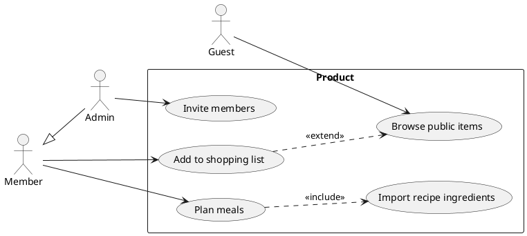

## Sequence diagram (a `puml` block)

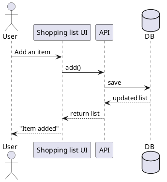

## Activity diagram

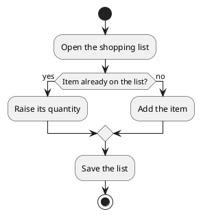

## Component diagram

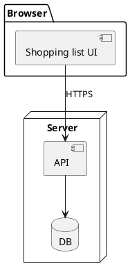

## State diagram

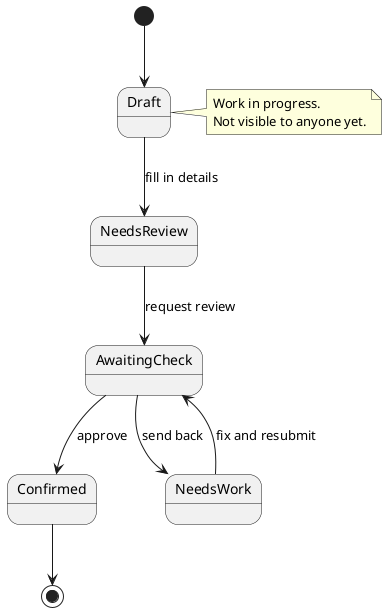

## Class diagram

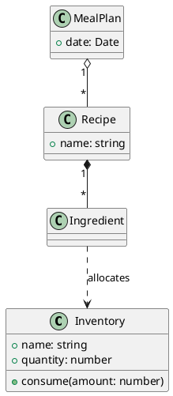

## Full-width text

Japanese and other full-width characters are measured and laid out like any other text, including labels that mix them with half-width ones.

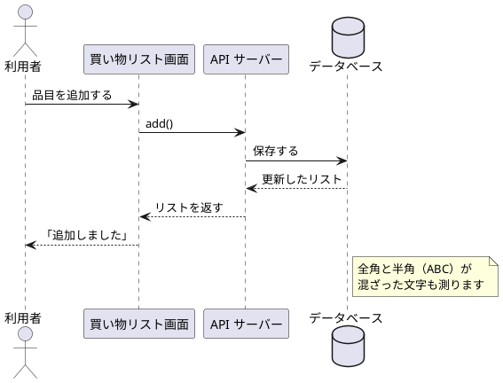

## Mind map, Gantt chart and JSON

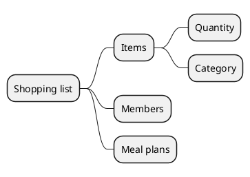

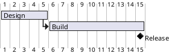

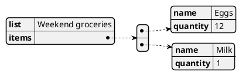

## Wireframe

```plantuml
@startsalt
{
  Login    | "MyName   "
  Password | "****     "
  [Cancel] | [  OK   ]
}
@endsalt
```

## Themes and icons

`!theme` picks one of PlantUML's themes, and `<&…>` draws an OpenIconic icon. A theme made for a white page, such as `cerulean`, gets the light palette in a dark editor, so that it stays readable.

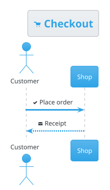

## Azure icons (bundled sprite library, no network)

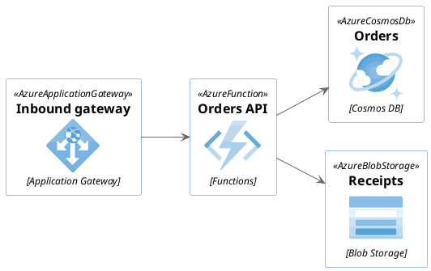

## C4 model (bundled library, no network)

C4's colours are made for a white page, so in a dark editor a C4 diagram that picks no theme gets the light palette, as the Azure one above does.

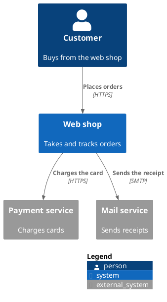

## Sprite written straight into the diagram

```plantuml
@startuml
sprite $box [8x8/16] {
FFFFFFFF
F000000F
F0FFFF0F
F0F00F0F
F0F00F0F
F0FFFF0F
F000000F
FFFFFFFF
}
rectangle "<$box>\n==inline sprite" as a
@enduml
```

## Including a file of the workspace

In a trusted workspace, `!include` reads a file next to this one: [sample-styles.iuml](sample-styles.iuml) colours the arrows and the participants. Ctrl+Click on the path opens it, hovering it says which file the diagram reads, and the diagram is drawn again when the file changes. *PlantUML Local: Show Diagram Dependencies* lists, in the Explorer, what each diagram of this document read: the file for the block below, the library files for the Azure and C4 blocks.

```plantuml
@startuml
!include sample-styles.iuml
Alice -> Bob : styled by the included file
@enduml
```

## Diagrams in block quotes and list items

> ```plantuml
> @startuml
> Alice -> Bob : Inside a block quote
> @enduml
> ```

1. A list item can hold one too:

   ```plantuml
   @startuml
   Bob -> Alice : Inside a list item
   @enduml
   ```

## Naming a block for export

The word after the language names the block. *PlantUML Local: Export All Diagrams as SVG and Update Image Links* writes `images/checkout-flow.svg` beside this file and a reference to it below the block, for hosts such as GitHub that show PlantUML as source. On the opening line of a block without a name, the light bulb offers *Name this diagram for export…*.

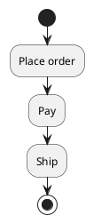

## Writing a diagram

In a block, suggestions open on `@` or `!` at the start of a line, on `$`, on `!theme ` and on `<&`. Outside a block, type `puml` and press `Ctrl+Space` for a whole block from one of sixteen templates, or run *PlantUML Local: Insert Diagram Template*.

Elsewhere in a block, `Ctrl+Space` lists what that diagram holds: its aliases with the names they show — `Shop` with `Web shop` in the block below — its words, and what it defines, as the next section shows. On a line of its own, a sequence diagram such as this one also offers snippets of `alt`, `opt`, `loop`, `par`, `ref` and `note`, and an activity diagram of `if`, `while`, `repeat` and `fork`, with their parts to tab through.

A swatch sits beside each colour a diagram sets, such as the two below; clicking it opens VS Code's colour picker, and the pick is written back as `#RRGGBB`.

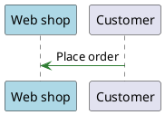

## Definitions, references and hovers

The block below defines a procedure, `$ask`, and a variable, `$parcel`. On a line of its own before `@enduml`, typing `$` offers both, each with its parameters and where it is defined. Picking `$ask` writes `$ask($request)` with `$request` selected — `$answer` has a default — and opens the parameter hints, which also open on `(` and `,` and show the parameter the cursor is in.

`F12` on a call of `$ask` goes to its `!procedure` line, and `Shift+F12` lists it with its three calls; on `Shop` in the body of `$ask`, `F12` goes to the `participant` line that declares it. Hovering `$ask` shows how it is declared and the comment above it, and hovering `!procedure` explains the directive, with how it is written and an example. In the C4 block above, `F12` on `Person` opens the bundled C4 file that defines it, read-only. A `.puml` file works the same.

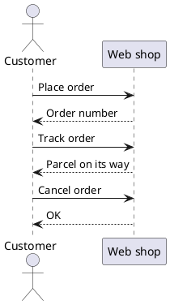

## What the preview reports

These blocks go wrong on purpose. Each gets a message in the preview, the rest of the page is unaffected, and the Problems panel lists them with their line.

### A library that is not bundled (reported, not fetched)

```plantuml
@startuml
!include <aws/AWSCommon>
Alice -> Bob
@enduml
```

### A formula in `<math>` (left blank, with a note)

```plantuml
@startuml
Alice -> Bob : <math>x^2 + y^2 = z^2</math>
@enduml
```

### An image from a file (drawn as text, with a note)

```plantuml
@startuml
Alice -> Bob :  Signed
@enduml
```

### Syntax error (only this block breaks)

```plantuml
@startuml
@@@ this is not valid syntax @@@
@enduml
```

### Remote reference (rejected with an explanation)

```plantuml
@startuml
!include https://example.com/theme.puml
Alice -> Bob
@enduml
```

### No `@enduml` (drawn anyway, with a note)

In the editor, the light bulb on its warning adds the end line.

```plantuml
@startuml
Alice -> Bob : This block has no end line
```

### A line above `@startuml` (drawn without it, with a note)

```plantuml
title This title is above @startuml
@startuml
Alice -> Bob : drawn without the title
@enduml
```

### Two diagrams in one block (a message instead of only the first)

```plantuml
@startuml
Alice -> Bob
@enduml
@startuml
Bob -> Alice
@enduml
```

## Other fenced blocks are untouched

```ts
export function add(a: number, b: number): number {
  return a + b
}
```

```bash
npm run bundle && npm test
```

```json
{ "name": "plantuml-local" }
```
